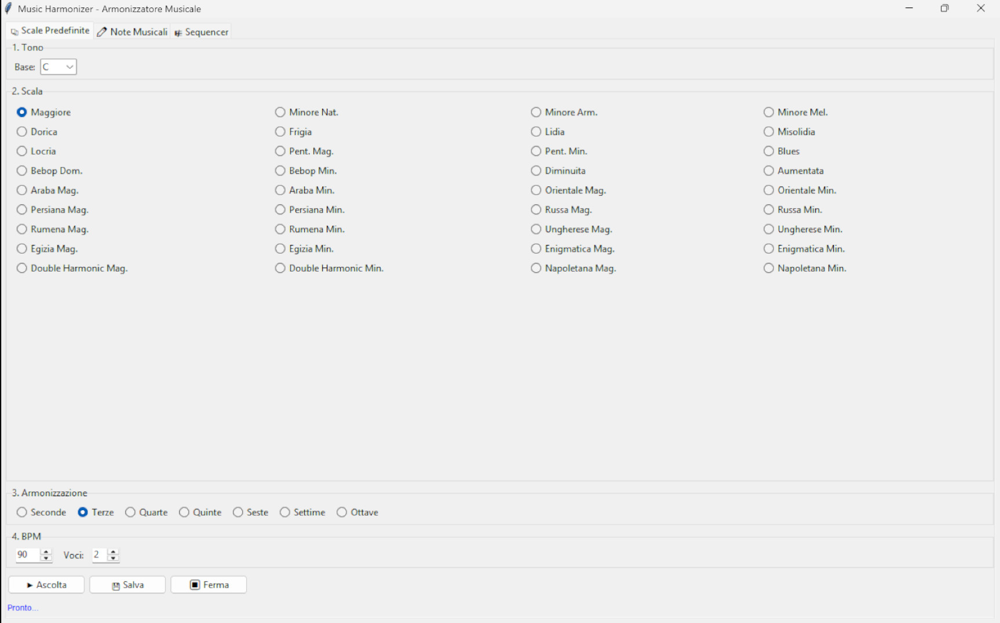
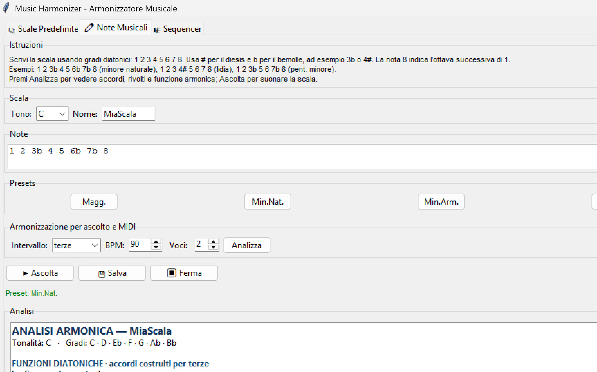
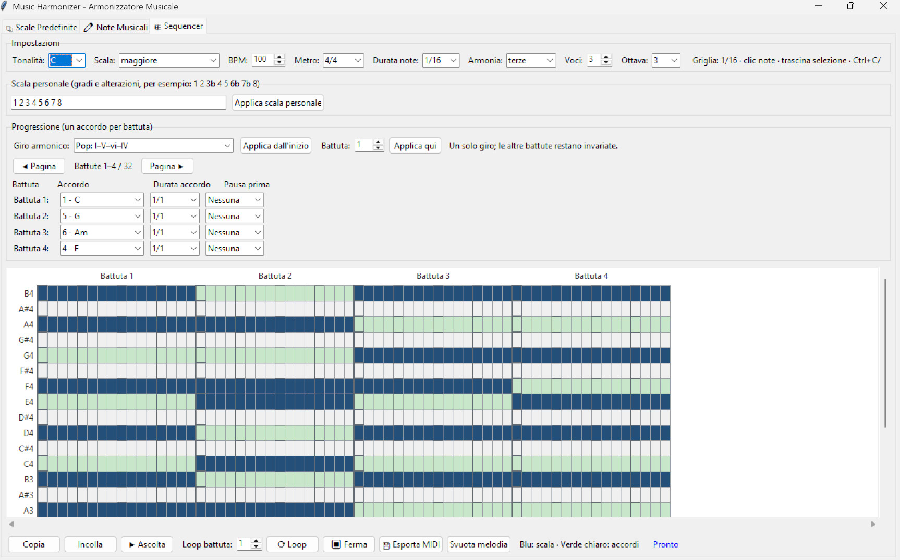

# 🎹 Music Harmonizer (Software Scale Harmonizer)

Welcome to the **Music Harmonizer** project! This open-source software is designed to automatically harmonize musical scales, helping developers and musicians build chords, map structures, and experiment with algorithmic compositions.

## Application

The desktop app uses Tkinter and includes scale analysis, chord harmonization, and a piano-roll sequencer. Its chord timeline supports mouse-based move and trim editing on a sixteenth-note grid, with synchronized timing controls and multitrack MIDI export.

See the [application guide](./musica-armonizzatore/music_harmonizer_repo/README.md) for features and setup. Install dependencies with `pip install -r musica-armonizzatore/music_harmonizer_repo/requirements.txt`, then run `python musica-armonizzatore/music_harmonizer_repo/music_harmonizer.py`.

## Screenshots

  
  
  

## 🚀 How to Contribute via Pull Request
We highly welcome contributions from the open-source community! If you want to improve the code, fix bugs, or add new musical features, please follow these steps:

1. **Fork** this repository to your own GitHub account.
2. **Clone** your fork locally to your PC.
3. Create a new development branch: `git checkout -b feature/your-feature-name`.
4. Make your code changes and commit them: `git commit -m "Add some awesome feature"`.
5. **Push** your branch online: `git push origin feature/your-feature-name`.
6. Open a **Pull Request** targeting our `main` branch, explaining your changes.

Thank you for helping us build better tools for music programming!

# 🎹 Music Harmonizer (Software-Skalen-Harmonisierer)

Willkommen beim Projekt **Music Harmonizer**! Diese Open-Source-Software wurde entwickelt, um Tonleitern automatisch zu harmonisieren. Sie hilft Entwicklern und Musikern dabei, Akkorde zu erstellen, Strukturen abzubilden und mit algorithmischen Kompositionen zu experimentieren.

## Anwendung

Die Desktop-App verwendet Tkinter und bietet Skalenanalyse, Harmonisierung und einen Piano-Roll-Sequencer. In der Akkord-Timeline lassen sich Akkorde mit der Maus auf einem Sechzehntelraster verschieben und in der Länge anpassen; die Zeitwerte werden mit den Eingabefeldern synchronisiert und als mehrspurige MIDI-Datei exportiert.

Die [Anwendungsdokumentation](./musica-armonizzatore/music_harmonizer_repo/README.md) enthält Funktionsübersicht und Installation. Abhängigkeiten installieren: `pip install -r musica-armonizzatore/music_harmonizer_repo/requirements.txt`; anschließend starten mit `python musica-armonizzatore/music_harmonizer_repo/music_harmonizer.py`.

## 🚀 So kannst du per Pull Request beitragen
Beiträge aus der Open-Source-Community sind herzlich willkommen! Wenn du den Code verbessern, Fehler beheben oder neue musikalische Funktionen hinzufügen möchtest, folge bitte diesen Schritten:

1. Erstelle einen **Fork** dieses Repositories auf deinem eigenen GitHub-Konto.
2. **Klone** deinen Fork lokal auf deinen PC.
3. Erstelle einen neuen Entwicklungs-Branch: `git checkout -b feature/dein-feature-name`.
4. Nimm deine Codeänderungen vor und committe sie: `git commit -m "Ein tolles Feature hinzufügen"`.
5. **Pushe** deinen Branch online: `git push origin feature/dein-feature-name`.
6. Öffne einen **Pull Request** auf unseren `main`-Branch und beschreibe deine Änderungen kurz.

Vielen Dank, dass du uns dabei hilfst, bessere Werkzeuge für die Musikprogrammierung zu entwickeln!
